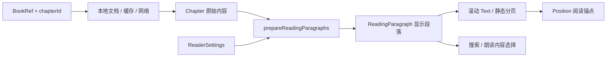

# 阅读器

[功能目录](README.md) · [文档首页](../README.md)

阅读器把原始章节按语言和译文偏好转换成显示文本，再交给滚动或分页布局。修改阅读器时，最重要的是保持**显示内容、阅读位置、搜索和朗读使用同一套语义**。

## 一章内容经过哪些步骤

| 修改内容 | 主要入口 |
| --- | --- |
| 阅读会话、切章、搜索任务与位置写入 | [ReaderScreen.kt](../../app/src/main/java/cc/novelia/app/ui/reader/ReaderScreen.kt) |
| 布局代次、字符锚点恢复与保存触发 | [ReaderPositionState.kt](../../app/src/main/java/cc/novelia/app/ui/reader/ReaderPositionState.kt) |
| 顶部工具栏、章内搜索栏与底部进度控件 | [ReaderToolbars.kt](../../app/src/main/java/cc/novelia/app/ui/reader/ReaderToolbars.kt) |
| 朗读与段落操作面板 | [ReaderActionSheets.kt](../../app/src/main/java/cc/novelia/app/ui/reader/ReaderActionSheets.kt) |
| 滚动正文的段落渲染、测量与命中高亮 | [ReaderTextParagraph.kt](../../app/src/main/java/cc/novelia/app/ui/reader/ReaderTextParagraph.kt) |
| 下一章加载、失败与取消 | [ReaderChapterLoad.kt](../../app/src/main/java/cc/novelia/app/ui/reader/ReaderChapterLoad.kt) |
| 原文/译文投影 | [Paragraphs.kt](../../app/src/main/java/cc/novelia/app/reader/Paragraphs.kt)、[LocalParagraphs.kt](../../app/src/main/java/cc/novelia/app/reader/LocalParagraphs.kt) |
| 精确锚点与搜索位置 | [ReadingAnchors.kt](../../app/src/main/java/cc/novelia/app/reader/ReadingAnchors.kt) |
| 纯分页算法 / Android 测量绘制 | [StaticPagination.kt](../../app/src/main/java/cc/novelia/app/reader/StaticPagination.kt)、[EInkPage.kt](../../app/src/main/java/cc/novelia/app/ui/reader/EInkPage.kt) |
| 整本搜索 | [BookTextSearch.kt](../../app/src/main/java/cc/novelia/app/reader/BookTextSearch.kt) |
| 偏好控件 | [ReaderPreferences.kt](../../app/src/main/java/cc/novelia/app/ui/reader/ReaderPreferences.kt) |
| 后台朗读 | [ReadAloudService.kt](../../app/src/main/java/cc/novelia/app/reader/ReadAloudService.kt)、[SpeechContinuation.kt](../../app/src/main/java/cc/novelia/app/reader/SpeechContinuation.kt) |

## 设置如何生效

实际设置取 `bookSettings[ref.key] ?: reader`。单书设置是一整份快照；修改默认值不会同步修改已有单书快照，关闭“仅应用于这本书”才重新继承默认值。

语言、引擎、并列译文和简繁变化需要重新投影；字体、字号、行距、段距与视口变化需要重新排版。昂贵计算放在 Default 调度器，滑块通常松手后提交，亮度等窗口效果在离开页面时恢复。

“阅读偏好 → 常用 → 阅读字体”支持系统默认、无衬线、衬线、等宽，以及导入 TTF、OTF、TTC 文件（最大 64 MB，TTC 使用默认字面）。选择时可预览中、英、日文，滚动正文和自动分页都会应用字体，切换后按阅读锚点重新定位。字体缺少的字符由 Android 回退；系统字体在不同设备上的实际字形可能不同。

字体入口以卡片展示当前选择，面板按字形预览、内置字体和导入操作分组，选择后即时生效；内容过长可滚动，底部“完成”和单书“恢复默认”保持可见。本机字体库可同时保存多款字体，支持多选文件导入；相同内容自动合并，部分文件失败不影响其他成功项，导入后应用最后一款成功的字体。“已导入”列表的每一项使用对应字体展示统一的中文、字母和数字样张，以相同字号和字重直接比较，无需切换；字体在后台加载，加载失败时明确提示不可用。列表可随时切换或确认删除；删除当前字体会切回系统字体，其他书籍引用的已删除字体暂用系统字体。旧版留下的字体文件会自动列出，能从默认或单书设置找回名称的保留原名，其余显示为“历史字体”。

字体选择随默认设置或单书快照保存，字体库及文件独立保存在本机，重新打开应用后仍可选择。文件在后台校验后复制到应用私有目录，不再依赖原始文件或文档授权，全部导入失败时保留原选择。旧设置默认使用系统字体。设置 JSON 和阅读资料 ZIP 仅保存选择与内容摘要，不打包字体库和文件；在另一设备恢复时需重新导入，否则暂用系统字体。WebDAV 保留各设备自己的字体选择，即使开启设备偏好同步也不覆盖。

自动分页由 `paginationMode == "auto"` 决定，普通屏幕也能使用。电子纸切换通过 `withEInkMode` 保存和恢复两种模式的偏好，旧字段仍有兼容逻辑。不要只翻转布尔值绕过它。

正文翻页按钮、连续滚动章末按钮、电子纸列表翻屏按钮、点击区域翻页、进度条和底部阅读信息是独立设置。字段和默认值以 [ReaderSettings.kt](../../app/src/main/java/cc/novelia/app/data/model/ReaderSettings.kt) 为准；控件范围、备份校验与预设切换需一起修改。

右上角提供朗读入口，底部工具栏提供阅读偏好入口。“阅读偏好 → 翻页 → 工具栏 → 底部阅读信息”默认开启，两种阅读模式都常驻显示当前时间、章节名（过长时单行省略）和本章进度；自动分页额外显示当前页／总页数，滚动模式按当前阅读位置显示百分比。时间遵循设备的时间格式，前台每分钟更新，回到前台立即刷新。底栏开关随默认或单书设置保存、备份和同步，不影响展开工具栏中的进度滑条。

阅读主题“跟随应用”按应用当前的深浅模式切换，默认与手动选择“浅色”或“深色”共用同一套背景、正文和工具栏配色。浅色使用淡绿阅读配色，深色沿用应用深色主题的色调；应用选择“跟随系统”时，阅读器也随系统切换。在“外观与操作”开启“A 屏黑”后，“跟随应用”的深色背景和工具栏改用纯黑，手动选择的阅读配色保持原样。

阅读主题可选“自定义”，分别设置字体、背景和工具栏颜色。点击颜色打开取色器：色相滑条和饱和度／明度取色盘支持连续选色，也可分别调整滑条或选择常用颜色。点击顶部“输入色值”进入精确输入界面，自动聚焦并选中原色值、唤起英文键盘，可输入 `#RRGGBB`（`#` 可省略），确认后应用；预览展示实际颜色，工具栏透明度继续单独调整。自定义配色随默认/单书设置保存，切换预设主题或电子纸不会丢失，恢复默认配色只重置颜色。

电子纸模式下，色相、饱和度和明度使用不小于 48 dp 的加减按钮调整，取色盘拖动只在松手后更新；弹窗沿用按屏翻动和静态反馈。手动输入仍使用独立的短输入界面，软键盘展开时可直接输入和确认，不依赖颜色渐变识别当前色值。

旧设置缺少 `customColors` 时使用纸张配色。普通设置 JSON、阅读资料 ZIP 和 WebDAV 设置范围均包含配色；WebDAV 将三种颜色作为一个字段同步，避免并发修改后拼出不同设备的文字与背景组合。

“阅读偏好 → 更多 → 进阶排版”可分别调整左右、上下页边距（0–64 dp），默认仍为左右 24 dp、上下 16 dp。两种阅读模式使用相同边距，调整后按字符锚点恢复阅读位置。页边距随默认或单书设置保存，普通设置、阅读资料备份和 WebDAV 可迁移，并不随电子纸预设重置。

宽屏目录可通过侧栏或底部工具栏的“收起目录”隐藏，再点击“目录”展开；设置中的“宽屏显示目录”控制同一偏好。收起时正文扩展，重排后恢复阅读锚点；目录数据和浏览状态仍在当前阅读会话中保留。目录显隐属于设备偏好，WebDAV 仅在开启设备偏好同步时迁移。

## 章节加载和切换

首次进入由 `AppController.chapter` 读取本地文件，或优先读取网络章节缓存。强制刷新必须实际请求网络，失败不能伪装为刷新成功。

切章采用“先加载，成功后跳转”：

1. 当前正文保留在屏幕上，`ReaderChapterLoad` 请求目标章。
2. 同目标不重复请求，改选目标会取消旧任务。
3. 成功后检查请求代次、会话、缓存代次和发起的返回栈项。
4. 保存当前位置，传递预加载结果和目录状态，再切换阅读路由。
5. 失败显示重试或取消；离开页面取消待切章任务。

目录查询、倒序和切章标记通过导航状态传递，入场标记只消费一次。窄屏每次打开目录定位当前章，宽屏常驻目录保留浏览位置。

目录数据与全书进度共用最近一本书的阅读会话快照，切章、重开目录或切换宽窄布局时复用。缺少当前章、落后于已知章节总数或手动刷新正文时补查目录，补查失败保留已有列表并允许重试；同一缺口不会随重组反复请求。从书架/详情重新进入阅读、换书、账号/书源变化或清理缓存后重新加载。

阅读器目录与作品详情目录共用缓存状态：显示已缓存范围，并在已落盘章节下标注“可离线阅读”。当前章同时保留“正在阅读”标记；读取、预取、批量缓存或清理缓存后，已打开的目录同步更新。

自动预读和手动离线缓存复用章节请求，数量、并发和落盘条件见[网络章节缓存](../network/network-and-sync.md#章节缓存和预读)。前台读到正文不一定表示离线副本已保存。

## 译文投影

在线章节按原文和各引擎段落数的最大值遍历，逐段选择内容：

- 非并列模式按 `engines` 顺序取首个可用译文；并列模式保留选中引擎的可用译文。
- `jp` 显示原文，`zh` 显示译文；`jp-zh` 和 `zh-jp` 决定双语顺序。
- 某段没有可用译文时回退原文，双语模式不会重复显示同一原文。
- 空段可从显示列表去掉，但保留原始段落索引；图片先识别为独立内容。
- 简繁转换只作用于译文，原文和日文回退保持不变。

本地 EPUB 的对照组由文件内容和可靠语言标记识别，独立于在线翻译引擎设置。已下载的多份译文保留；无法可靠配对的正文显示一次，不按奇偶段或文件名猜语言。解析和旧文件恢复见[文件与下载](files-and-downloads.md)。

## 阅读位置为什么不能只存页码

字号、方向或译文改变后，页码和像素位置都会变。阅读器保留段落与字符锚点来跨布局恢复，同时兼容原有列表位置。

| 坐标 | 含义 |
| --- | --- |
| `ReadingParagraph.index` | 原始段落索引；笔记 `Note.paragraph` 使用它 |
| 显示段落下标 | 投影列表中的位置；空段过滤后可能不同于原始索引 |
| `Position.index` | 兼容滚动列表的下标；第 0 项是标题，正文下标需加 1 |
| `textOffset` / `offset` | 段内显示字符偏移 / 当前滚动布局的像素偏移 |

例如原始第 2 段被过滤后，原始第 3 段在显示列表里会前移；把显示下标直接当笔记原始段号，就会跳错内容。

搜索命中的 `part/start/end` 相对于某份语言文本。转换为段内字符坐标时，还要加上双语换行、引擎标签和缩进。修改任何显示前缀，都要同步锚点计算和两种渲染器。

滚动模式等待真实文字布局后把字符换算为行位置；分页模式把字符锚点映射到测量页。语言或正文变化时优先保留同一原文段，失效的字符/像素偏移应清除。布局代次变化要取消旧定位任务，避免新文字套用旧几何信息。

`ReaderPositionState` 在页面原有的章节 `key(ref, chapterId, chapter)` 内创建，跨本章重排保留恢复状态；`ReaderPositionLayout` 组合当前段落、设置和布局测量。恢复与保存触发集中在 `ReaderPositionEffects`，保留滚动停稳防抖、模式切换和生命周期的触发条件，最终由页面写入位置。工具栏和操作面板只展示状态并发出回调，切章、搜索协程和资料写入仍由页面协调。

## 进度、历史和查阅返回

滚动停稳后会防抖保存，分页变化、切章、返回和生命周期结束也保存。恢复锚点、重新排版或视口尚未就绪时不提交中间位置。

**暂停阅读历史仍保存续读位置。** 当前 [ReadingProgress.kt](../../app/src/main/java/cc/novelia/app/data/library/ReadingProgress.kt) 分开维护 `positions` 和 `readingHistory`；暂停或清空历史不清除位置。暂停时也不继续上报原站阅读历史。

书架全书进度按到达章节计算，章内进度按布局计算。进入最新已知章节可以显示 100%，但不等于用户手工标记“读完”。原站只上报章 ID，WebDAV 则可同步网络书籍的段落锚点，见[书架](library.md)和 [WebDAV](../network/webdav-sync.md)。

目录或搜索的首次实际跳转会保存临时 `ReadingReturnPoint`，供“回到刚才阅读处”。后续查阅保留同一起点，跨章返回成功后才消费它；这个临时位置不替代普通续读记录。

## 滚动、分页与输入

工具栏是正文上方的覆盖层，开关菜单和搜索框不改变正文视口。两种模式都为已开启的底部阅读信息固定预留空间；只有切换底栏设置时才调整视口，避免每次开菜单都重新分页。

开启“阅读时隐藏状态栏”后，滚动与分页正文延伸到屏幕顶部，不再为顶部缺口保留整条空白；横屏两侧和底部仍保留安全边距，工具栏、目录和点击引导继续避让系统区域。

阅读偏好默认半屏展开。向上拖动面板顶部的拖动条或标题区域可展开为大半屏，大半屏下轻轻向下拖动即可回到半屏；半屏下继续较大幅度下拖可关闭面板。展开按钮仍可切换高度，设置列表与滑条独立处理各自的滚动和调整手势，电子纸或减少动效时切换高度不播放动画。

| 模式 | 实现和交互 |
| --- | --- |
| 连续滚动 | LazyColumn；翻屏约移动视口的 85%；章末可上拉请求下一章 |
| 自动分页 | StaticLayout 测量整章，按完整行分页；插图独占一页；普通模式拖动时同时展示当前页和相邻页，松手提交或回弹 |
| 点击区域翻页 | 默认关闭；开启后按可调大小的网格响应单击和双击，每格可单独设置动作，相同动作的邻格自动合并 |
| 章内进度条 | 滚动按显示字符权重定位，分页选已测量页；两端不触发跨章 |

点击分区默认把正文划成等分的 3 × 3 网格（[ReaderTapZoneMap.kt](../../app/src/main/java/cc/novelia/app/reader/ReaderTapZoneMap.kt)），命中测试使用当前列宽、行高的归一化边界，越界坐标夹到边界格子，视口宽高为 0 时不响应。每格可独立配置单击与双击动作，动作集合为上一页、下一页、打开目录、显示工具栏、无响应；「无响应」不打开菜单，仍可滑动、长按或操作正文控件。

默认方案是四向翻页：左列与中上格上一页，右列与中下格下一页，正中显示工具栏；双击在顶部三格打开目录、底部三格切换工具栏。有双击动作的区域会等待系统双击时限后确认单击；双击只执行双击动作，没有双击动作的区域单击即时响应。

“阅读偏好 → 翻页 → 在正文上配置点击区域”打开覆盖在当前正文上的半透明编辑层（[ReaderTapZoneEditor.kt](../../app/src/main/java/cc/novelia/app/ui/reader/ReaderTapZoneEditor.kt)）。拖动横纵分界线调整整行、整列的大小，每行、每列至少占视口的 8%；点按区域从底部弹层选择动作，底部切换单击／双击。上下左右相邻且两种动作均相同的格子自动合并，斜角不合并；“逐格编辑”保留底层网格，可单独改回某个格子。保存才应用草稿，取消或返回放弃本次编辑，恢复默认同时还原大小和动作。全局设置没有打开正文时使用示例正文预览。

编辑靠近屏幕边缘的小区域时，可点击底部隐藏控件按钮临时收起上下控制栏，再用“显示配置控件”恢复。教程从当前配置生成，设置中可重新查看；教程、编辑层、点击命中与翻页反馈共用正文视口和区域边界。翻页反馈仅以低透明度轻微高亮实际命中的合并区域，不绘制描边；电子纸使用静态淡色反馈。自动分页在电子纸或减少动效时直接切页；关闭手势、打开面板或出现多指时不提交拖动翻页。连续滚动仍使用原有列表拖动。

方案连同每格动作、行列分界编码为字符串存入 `ReaderSettings.tapZoneMap`；兼容旧版等分网格，空值或无法解析时回退到默认方案。完整的旧默认方案会把中央工具栏语义迁移为明确的 Menu，不覆盖自定义的无响应区域。该字段属于设备偏好，随 WebDAV「设备偏好」组同步，不进入可移植偏好组；旧设备偏好组缺少该字段时仍可读取，并保留本机分区。

分区映射改编自 [FBReaderJ](https://github.com/geometer/FBReaderJ) 的 `TapZoneMap`（GPL-2.0-or-later），来源与修改记录见 [NOTICE.md](../../NOTICE.md)。

点击必须与长按选字、拖动、多指、图片操作和取消区分。章末上拉也只在有效手势松手时提交。电子纸与减少动效使用静态反馈；面板打开时不要拦截属于表单的按键。

## 搜索、图片和笔记

章内搜索针对实际显示文本，支持一段内多次命中。整本搜索读取本地文档或**已缓存的网络章节**，不会自动下载整本；没有完整离线目录时会降级并说明范围。结果数量和扫描量有上限，截断或缺缓存不能解读为全书没有命中。

图片在滚动正文预留位置，分页中独占一页。长按进入全屏查看，电子纸提供按钮操作。正文长按可选字、分享和记笔记；笔记保存原始段落索引，不能使用标题偏移后的列表下标。

长按文字段落打开“选文与对照”。面板展示本段已有的原文、Sakura / GPT / 有道译文；本地 EPUB 仅展示可可靠配对的版本，普通本地正文不会猜测配对。版本在后台整理，切换只影响面板，不改变整章语言或请求新译文。

在版本正文内长按并拖动选区，或点击“全选”，可复制选文、分享选文、查词 / 翻译、划线和写批注。操作使用精确选区，同一段可保存多条批注；未选中文字时相应操作禁用。查词最多接受 2000 字，通过 Android 的只读选文处理入口交给用户选择的应用，未安装支持的词典或翻译应用时提示复制或安装，不自动发起网络查询。

批注保存原始段号、来源、同源版本序号、UTF-16 字符范围和摘录。滚动和分页正文均显示已保存的划线；译文更新后只接受仍匹配的范围或唯一摘录，无法可靠定位时保留记录但不误标正文。未显示批注对应语言时不标记其他版本。从笔记返回正文时优先定位精确选文，不可用时回到原段。批注清空文字仍保留划线；删除记录可撤销。面板可编辑本段记录，也可进入“本书书签与批注”。旧版段落书签仍兼容，新批注随阅读资料备份和 WebDAV 的笔记范围保存。

“阅读偏好 → 更多 → 进阶排版”的阅读方向可选跟随系统、竖屏、横屏，支持默认与单书设置。方向由根导航统一控制，离开阅读器恢复跟随系统，跨章和横竖屏重建不会由旧页面重置方向。该偏好属于 WebDAV 可选设备偏好组；旧数据默认跟随系统。

## 自动阅读

顶部工具栏的“自动阅读”可从当前位置启动。连续滚动按 5–80 dp/秒调速；分页和墨水屏每 5–120 秒翻过一页或一屏，避免持续刷新。章末停留后自动接续下一章，末章停止，有下一分卷时由用户确认。触碰正文、打开菜单、切到后台、离开阅读器或重建 Activity 均暂停；加载失败保留本章和重试入口，重试后保持暂停。运行期间保持亮屏，暂停后恢复原亮屏设置。

速度与停留时间遵循当前默认或单书设置，支持备份和 WebDAV 同步。运行状态只属于当前前台阅读会话，不随设置保存，不在重启后自动开始。自动阅读和朗读入口会暂停对方，避免同时控制正文位置。

## 系统朗读

朗读由 Android TTS 前台服务执行。服务按选定语言和同一投影规则建立句子队列，忽略图片；暂停后继续会重读当前句，不承诺字级恢复。

句子队列保留原始段落、文本来源和字符范围。当前句在滚动和分页正文中高亮，可开启跟随，自动定位到正在朗读的句子及续章；后台、其他书籍及操作面板中不会强行跳转。手动触摸正文、翻页或搜索暂停跟随，朗读继续，可从朗读面板重新开启。面板显示当前句并提供上一句、下一句；暂停时切句保留暂停状态。段落选文面板支持仅朗读精确选区，读完选文即停止，不续章。

连续听书优先本地/缓存，只有开启联网续章时才读取缺失章节。失败暂停并保留目标供重试，空章可跳过，循环章节会停止。播放绑定开始时的会话，旧回调不能推进后来启动的新队列。

长正文先写私有临时队列文件，Intent 只传队列 ID，避免 Binder 大载荷。定时停止沿用一次播放的原期限，跨章、暂停和重试不会重置。真实语言包、音频焦点和通知按钮需要设备验收。

## 选择回归范围

纯规则优先看 `ReaderProjectionTest`、`ReaderPreferencesTest`、`ReaderExactSearchTest`、`StaticPaginationTest`、`ReaderChapterLoadTest`、`ReadingProgressUpdatesTest` 和 `SpeechContinuationTest`，位于 [JVM 测试目录](../../app/src/test/java/cc/novelia/app)。

布局与手势看 [ui/reader 设备测试](../../app/src/androidTest/java/cc/novelia/app/ui/reader)。至少检查滚动/分页互换、双语、大字号、横屏、工具栏开关、断网切章和后台再前台；锚点改动增加超长段落、空段和插图混排。执行方法见[测试指南](../quality/testing.md)。
